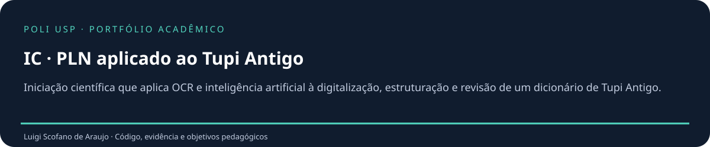

<p align="center"></p>

# IC · PLN aplicado ao Tupi Antigo

**Preservar a fonte, explicitar a incerteza e tornar a revisão auditável.**

[](https://github.com/luigiscofano/ic-pln-tupi-antigo/actions/workflows/verificacao.yml)

Portfólio de **Luigi Scofano de Araujo · Engenharia de Computação, Poli-USP · USP 13680334**. Organização e complementos de 2026 com assistência de IA, distinguindo acervo recuperado e implementações novas. [Procedência](docs/PROCEDENCIA.md).

## Objetivos pedagógicos em destaque

- **Separar fonte e interpretação** — Manter lemma_raw e cópia NFC.
- **Tratar ausência sem inventar** — Manter tradução vazia.
- **Preservar homógrafos** — Manter IDs distintos para lema igual.
- **Avaliar OCR** — Calcular CER/WER em pares alinhados.
- **Distinguir validações** — Separar aprovação funcional e correção linguística.
- **Documentar revisão** — Manter pendências até uma decisão documentada.

**[Atividades, evidências e rubrica →](docs/OBJETIVOS_PEDAGOGICOS.md)**

## Execute e experimente

```sh
python -m pip install -r requirements.txt
python -m unittest discover -s tests -v
python scripts/processar.py data/demo.tsv --saida build
python scripts/executar_notebooks.py
```

Ambiente: **Python 3.12, Unicode e Jupyter**. [Instalação detalhada](docs/INSTALACAO.md).

## Encontre cada parte

| Diretório | Conteúdo |
| --- | --- |
| [tupi/](tupi/README.md) | Auditoria, métricas, OCR opcional e documentação de revisão. |
| [acervo/](acervo/README.md) | Situação do Colab recuperado, cujo conteúdo aguarda autorização específica. |
| [notebooks/](notebooks/README.md) | Demonstração nova executável com fixtures sintéticas. |
| [data/](data/README.md) | Três linhas fictícias; não é o corpus histórico nem léxico validado. |
| [tests/](tests/README.md) | Preservação Unicode, homógrafos, exportação e métricas. |
| [scripts/](scripts/README.md) | CLI de importação, relatórios e execução do notebook. |
| [assets/](assets/README.md) | Fluxo metodológico e gráfico descritivo do diário. |
| [docs/](docs/README.md) | Arquitetura, objetivos, reprodução, apresentação e evidência |

## Verificação e limites

Nove testes unittest de preservação, alertas, homógrafos, round-trip CSV/JSONL, entradas inválidas, NFC com diacríticos, distâncias conhecidas e referências vazias. Notebook novo com três células de código e asserções.

Sem benchmark real de OCR, validação linguística protocolada, fine-tuning ou tradutor; sem corpus integral distribuído; Colab e funções derivadas aguardam autorização específica; adaptador OCR não avaliado em corpus real.

**[Validação →](docs/VALIDACAO.md)** · **[Arquitetura e decisões →](docs/ARQUITETURA.md)**

Use o [roteiro de apresentação](docs/APRESENTACAO.md) e confira os [PRs reais](docs/PUBLICACAO.md). As branches representam organização atual, sem datas retroativas ou revisões fictícias.

[Contribuir](CONTRIBUTING.md) · [Direitos e créditos](DIREITOS_E_CREDITOS.md) · [Referências](docs/REFERENCIAS.md) · [Mudanças](CHANGELOG.md)
