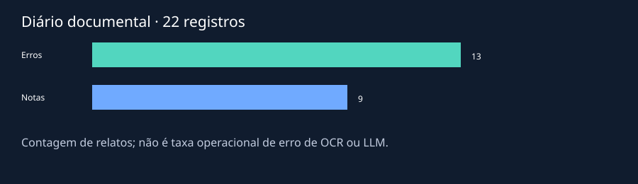

# Visualizações e identidade

[Início](../README.md) · [Como executar](../README.md#como-executar) · [Aprendizagem](../README.md#o-que-desenvolvi-e-aprendi) · [Estado atual](../README.md#estado-atual)

> **Nesta área:** figuras e evidências visuais; imagens ilustrativas e resultados de execução devem ser distinguidos conforme a legenda.

[Início](../README.md) · [Como executar](../README.md#como-executar) · [Aprendizagem](../README.md#o-que-desenvolvi-e-aprendi) · [Estado atual](../README.md#estado-atual)

> **Nesta área:** figuras e evidências visuais; imagens ilustrativas e resultados de execução devem ser distinguidos conforme a legenda.

O gráfico mostra 13 registros de erro e nove notas/observações do diário autorizado. É uma contagem documental, não taxa operacional de falha. [Contexto e limites](../docs/METODOLOGIA.md).

A capa foi criada nesta edição com texto e geometria. O [notebook novo](../notebooks/01_auditoria_reproduzivel.ipynb) usa três registros sintéticos; o [Colab recuperado](../acervo/README.md) permanece identificado separadamente.

---

**Projeto:** [IC · Dicionário de Tupi Antigo, OCR e revisão de dados](../README.md). Consulte a raiz para os requisitos e o primeiro comando; este guia aprofunda a área `assets/`.

---

**Projeto:** [IC · Dicionário de Tupi Antigo, OCR e revisão de dados](../README.md). Consulte a raiz para os requisitos e o primeiro comando; este guia aprofunda a área `assets/`.
