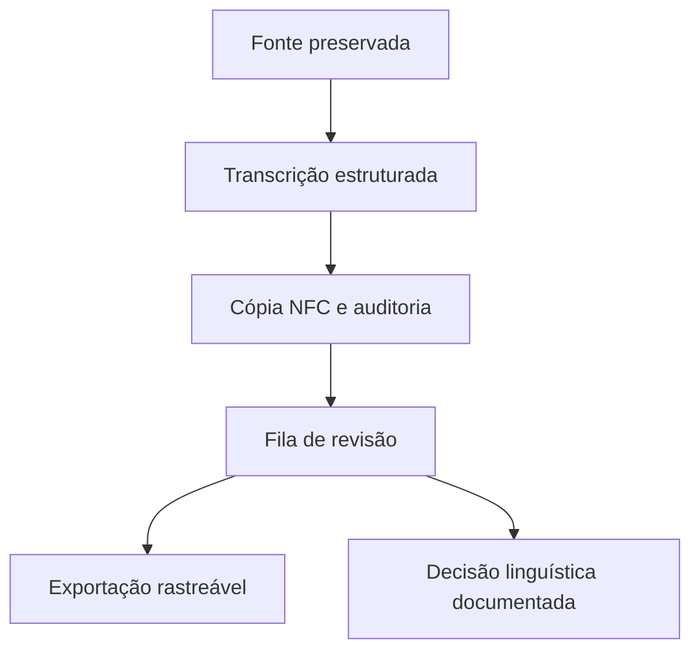

# Arquitetura e contratos

## Preservação e esquema

Entrada TSV, com cabeçalho exato: id, source_id, page, line, lemma_raw, pt_raw, en_raw. IDs únicos e não vazios; fonte obrigatória; página e linha positivas. Colunas a mais/menos são erro, sem reparo silencioso. Original é preservado; lemma_nfc acrescenta cópia canônica e status=pending_review evita confundir importação e validação.

source_id é identificador editorial local, não ID ou link privado do Drive. Campos de tradução podem permanecer vazios. O auditor sinaliza ausência, caractere de substituição, controles, mudanças canônicas e possíveis homógrafos/duplicatas. Não apaga registros: mesma escrita pode representar sentidos legítimos distintos.

## NFC não é correção ortográfica

NFC pode compor a+til em ã, preservando equivalência canônica. Não escolhe uma ortografia, remove acentos ou troca grafemas. O Colab recuperado e suas funções estão publicados no acervo e em tupi/legado.py. Eles não integram o importador padrão. As heurísticas são testadas como comportamento de código e o núcleo da exportação é executado em fixture sintética, sem alegação de validação linguística.

## Métricas

CER é distância de edição em code points dividida pelo tamanho da referência; WER usa tokens separados por espaços. Não há NFC implícito nas métricas: o protocolo de avaliação precisa declarar o pré-processamento. Referência vazia gera ValueError. Taxas podem exceder 1 por inserções. O cálculo custa O(nm) tempo e O(m) memória; não mede tradução ou correção semântica.

## OCR e LLM

ocr.extrair chama Tesseract local com imagem, idioma e PSM explícitos, sem shell e com timeout. Exige instalação separada de binário e modelos. Não foi medido em benchmark real do dicionário. A demonstração principal começa de TSV já estruturado; não oculta essa etapa manual.

Há um protocolo de prompting e revisão, mas não integração automática de LLM, chaves de API, fine-tuning ou tradutor. Os três registros de demo.tsv são fictícios e não comprovam conhecimento linguístico.

